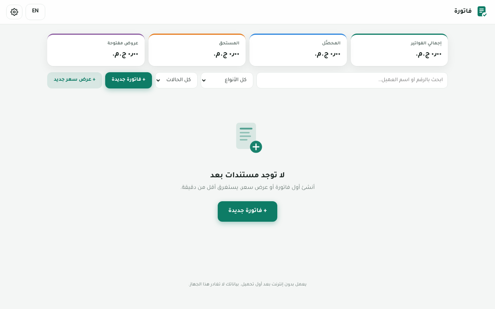
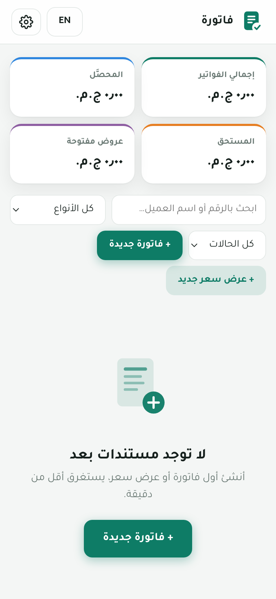
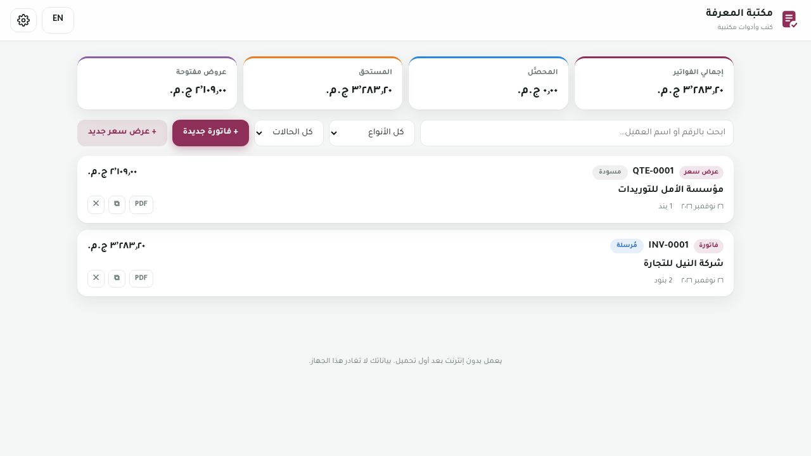
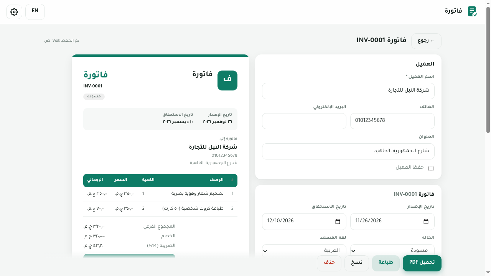
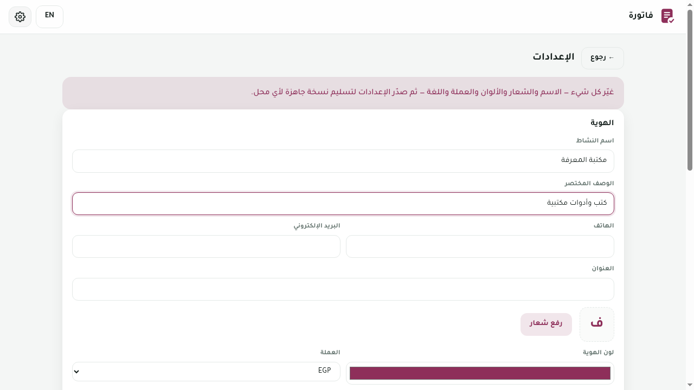

<div align="center">


# Fatora · فاتورة

**Free Arabic & English invoice and quote generator, with PDF export right in your browser.**

[](https://yousefkhames.github.io/fatora/)
[](LICENSE)

</div>

---

## Screenshots

Captured from the live site (https://yousefkhames.github.io/fatora/).

<p>
  
  
</p>

## What is it?

Fatora (فاتورة, "invoice") is a small, fast, fully client-side web app for freelancers and
shops that need clean invoices and price quotes in **Arabic, English, or both**, with proper
RTL layout, Arabic-Indic numerals, and one-click **PDF export** that never leaves the device.

No accounts. No server. No fees. Open the page and start billing.

**Live app:** https://yousefkhames.github.io/fatora/

## Screenshots

<p>
  
  
  
</p>

## Features

- **Invoices & quotes**, separate numbering sequences (`INV-0001`, `QTE-0001`), statuses
  (draft / sent / paid / overdue / accepted / rejected), and one-tap **quote → invoice conversion**.
- **Real document math**, per-line amounts, percent or fixed discount, configurable tax rate,
  amount-paid tracking with balance due, all computed in integer cents and rounded half-up.
- **Bilingual to the bone**, full Arabic/English UI with proper RTL/LTR switching, and each
  document can be rendered in either language regardless of the UI language.
- **In-browser PDF export**, the invoice sheet is rendered to a multi-page A4 PDF locally
  (html2canvas + jsPDF, vendored, no CDN at runtime), plus a print-optimized layout for
  `Ctrl/Cmd+P`.
- **White-label ready**, business name, tagline, logo, brand color, currency (11 currencies),
  default language, tax, number prefixes, terms and footer are all editable in Settings, and the
  whole branding pack **exports to JSON** so one codebase can be handed to any shop.
- **Clients**, save client details once, reuse them on every document.
- **Dashboard**, totals for invoiced / collected / outstanding / open quotes, with search and
  filters by type and status.
- **Private by design**, everything lives in `localStorage`; full JSON backup/restore and
  one-click **CSV export** of all documents for your accountant.
- **Mobile-first**, designed for a phone screen first, with a side-by-side editor + live
  preview on desktop.

## Tech

- Vanilla HTML/CSS/JS, no build step, no framework.
- [`html2canvas`](https://html2canvas.hertzen.com) + [`jsPDF`](https://github.com/parallax/jsPDF)
  (vendored in `vendor/`) for local PDF generation.
- Google Fonts: Tajawal (Arabic) & Inter (English).
- Pure-logic core (`js/core.js`) is environment-agnostic and unit-tested with Node's built-in
  test runner.

## Development

```bash
# run the unit tests (money math, numbering, i18n parity, import sanitizing)
node --test tests/core.test.js

# full DOM click-through (dashboard, editor, settings, conversion)
npm install jsdom
NODE_PATH=node_modules node tests/smoke.test.js

# serve locally
python3 -m http.server 8000   # then open http://localhost:8000
```

Deploying your own copy: push this repo to GitHub and enable **Settings → Pages → Deploy from
branch (main, root)**, that's it.

## Honest limits

- The exported PDF is **raster** (rendered image pages), so text in it is not selectable;
  use the Print button for a fully vector PDF via the browser's print dialog.
- Fonts (Inter, Tajawal) are bundled in `fonts/`, so there are no third-party requests; the very
  first visit needs a connection, then everything works offline.
- Data lives in the browser's `localStorage` of one device, use the JSON backup to move
  between devices. Clearing site data erases your documents.
- No multi-currency per-document (one currency per installation), no recurring invoices,
  no online payments, by design, to stay tiny and free.

## License

[MIT](LICENSE) © 2026 Yousef Khames

## Round 2 review notes
- Inputs accept Arabic-Indic digits and decimal commas; absurd values are ignored instead of breaking totals.
- Backup import is sanitised and asks for confirmation before replacing data; failed saves show a message.
- Limits: WhatsApp links are only checked as generated wa.me URLs (not opened in the WhatsApp app); no cloud sync, data stays in this browser.


## Demo / portfolio project

Static GitHub Pages site. Data stays in your browser. Sample data is fictional and results are not professional, legal, medical or financial advice.

By Yousef Khames · من تطوير يوسف خميس
